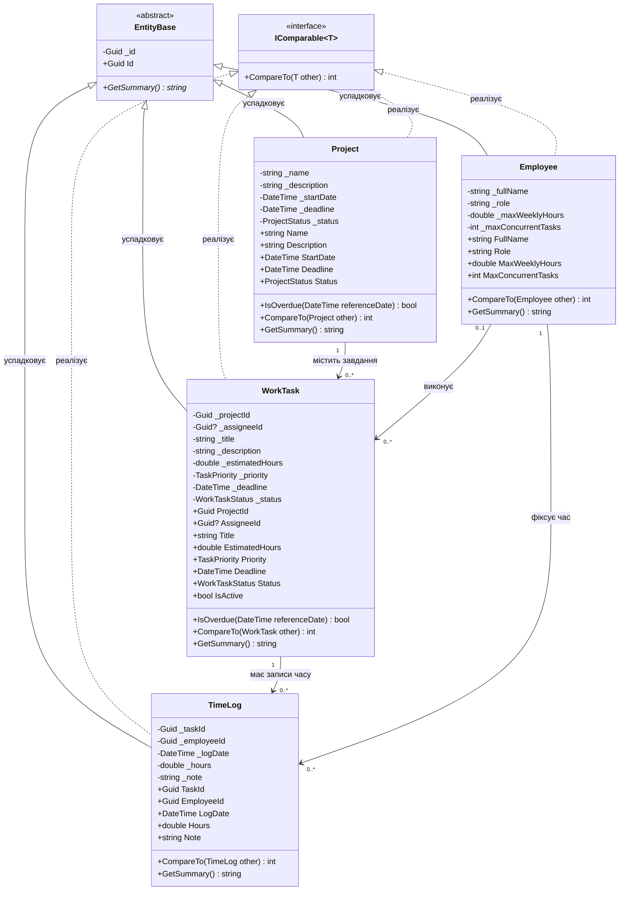
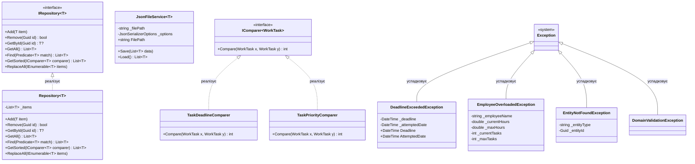
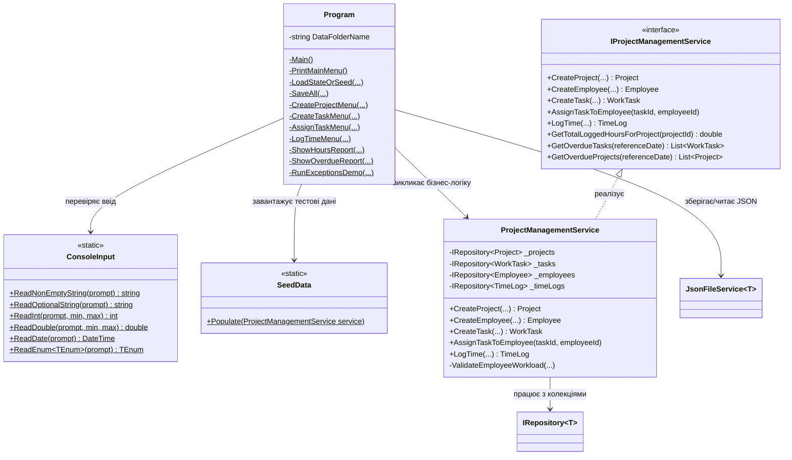
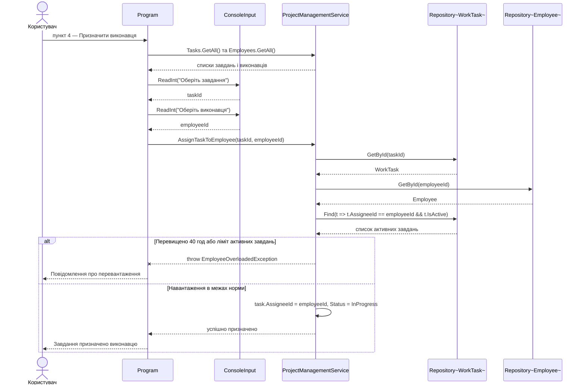
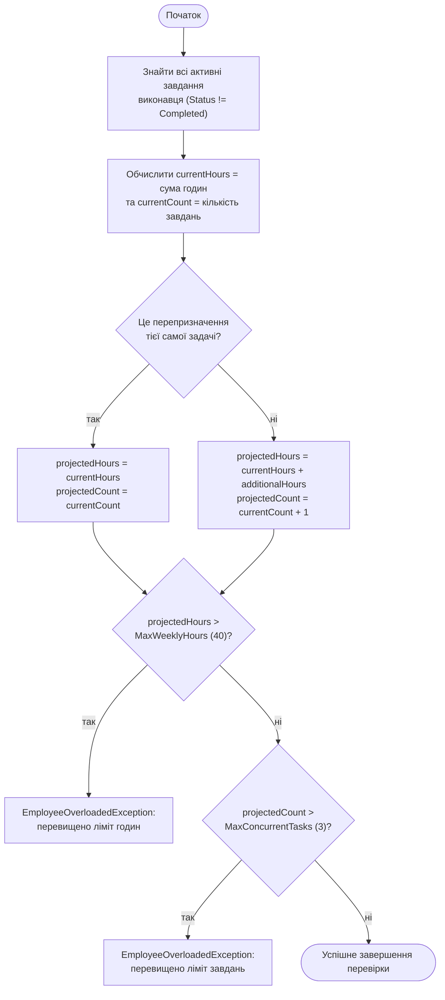
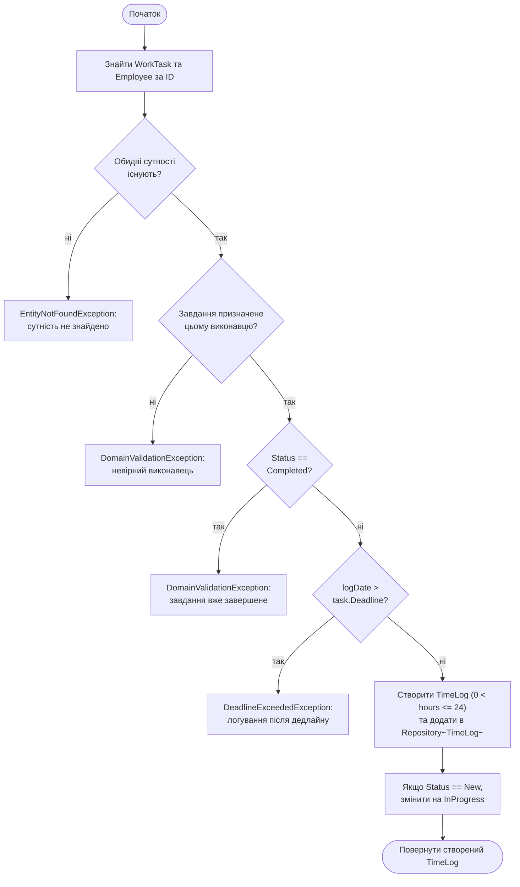

# Діаграми архітектури та алгоритмів проєкту (Варіант № 17 — Управління IT-проєктами)

## 1. Діаграми класів

### 1.1. Предметна область: сутності та зв'язки (`Domain.Core/Models`)

---

### 1.2. Збереження даних: репозиторій, компаратори, серіалізація та винятки (`Domain.Core`)

---

### 1.3. Керування: меню, валідація вводу та бізнес-логіка (`Domain.UI` + `Domain.Core`)

Класи `ProjectManagementService`, `Repository<T>`, `JsonFileService<T>`, моделі та винятки винесені в окрему бібліотеку `Domain.Core` (.dll). Консольне меню, `ConsoleInput` та `SeedData` належать проєкту `Domain.UI`.

---

## 2. Взаємодія об'єктів: призначення завдання виконавцю

---

## 3. Блок-схеми алгоритмів бізнес-логіки

### 3.1. Перевірка навантаження виконавця (`ValidateEmployeeWorkload`)

---

### 3.2. Алгоритм обліку витраченого часу (`LogTime`)

